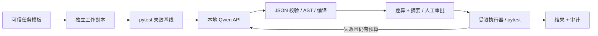

# 架构与设计取舍

## 最小工作流

审批门前保存提案但不执行。模型看见需求、当前单文件、公开测试和公开测试失败信息；holdout 文件不进入提示，holdout 失败详情不反馈给模型。需求本身覆盖 holdout 约束。holdout 是本地评测文件，并非有权限保护的远程保密题库。模型测试失败后可再次提案，最多三次，每次独立批准。

## 为什么这样取舍

| 选择 | 收益 | 限制 |
|---|---|---|
| Ollama 首先实跑 | Windows 便携启动、GGUF 量化、单 GPU 门槛低 | 本次未证明高并发生产 Serving |
| 同一 `/v1/chat/completions` 客户端 | Ollama/vLLM 切换只改 URL 和模型名；不用额外 SDK | 需要支持 JSON schema 的服务版本，不静默降级 |
| 完整单文件 JSON | 小模型更易生成；无路径穿越/patch 上下文歧义 | 不能代表多文件真实工程修复 |
| 手动批准后才执行 | 明确的人机边界；审批对象可检查 | 增加延迟；只是本地身份声明 |
| 受限 Python 子集 + 默认 Docker | 少量代码即可展示控制与隔离 | AST 会拒绝正常 Python 写法；Docker 也不是虚拟机级隔离 |
| 固定公开/holdout 测试 | 避免模型通过修改测试“成功” | 题目很小，测试覆盖仍有限 |
| JSON/JSONL + 静态 HTML | 易检查、可复制、无需数据库和服务前端 | 单用户、小规模；无分布式调度与审计存证 |

## 安全边界

模型没有 shell、HTTP、文件工具或安装工具。不能选择其他源文件、修改测试、访问真实业务仓库。只传入白名单任务；运行目录不挂载主仓库、凭据或用户 home。API 地址限定 loopback，禁用环境代理与 HTTP 重定向，没有云 API 回退。

AST 白名单拒绝导入、私有属性、反射、动态执行、任意调用、类、while、装饰器等；执行仅注入选定 builtins。它限制代码能力，但不是通用 Python 安全沙箱。`set.add` 被拒绝属于刻意收窄的功能范围，不能称为恶意代码检测。宿主 restricted 模式仅用于经人工审阅的可信演示，资源耗尽仍是风险。

默认 Docker：无网络、根文件系统只读、工作目录只读、非 root、去 capabilities、no-new-privileges、256MiB 内存、1 CPU、32 PID、32MiB 临时目录、20 秒超时。只运行固定 pytest 命令；候选代码仍通过同样策略。镜像构建可联网安装依赖，运行时 `--pull=never`，不自动安装任何包。Docker daemon/socket 从不交给生成代码。生产中的敌对代码应再用专用宿主/VM 或更强沙箱。

不承诺只靠代码就“保证不外传”：运行期出站网络必须在基础设施层默认拒绝，推理服务也要禁用云模型/遥测并离线加载。代码、完整模型响应和测试日志会保存在本地 evidence，按内部源代码等级做 ACL、保留期限与清理；不接入外部分析平台。

## 评测定义

- 一次运行是一项任务的一次 trial，从原始失败模板开始，最多三个提案，不是三个独立采样。
- 成功：策略允许、人工批准、pytest 返回 0、收集的测试数量与基线一致、没有跳过。
- 首次成功：第一份提案执行成功。`temperature=0` 提高稳定性，不保证跨 GPU/版本逐位确定性。
- 全流程成功率：成功运行 / 全部启动运行。它包含策略和基础设施摩擦，是本 PoC 主要数字。
- 已完成执行评测成功率：succeeded / (succeeded + failed)。同时展示 pending、blocked、rejected、model/API error、infra error 数量，防止选择性报告。
- 语法在 AST/compile 阶段检查；缺少约定函数导致 pytest collection 失败算模型修复失败。执行器启动失败单独归类基础设施错误。
- 编译和测试通过证明本题测试覆盖下的行为，不证明所有代码安全、功能完整或没有回归。公开和 holdout 中都包含边界、非法输入、顺序和不变性回归检查。

原始数据包括模型名与摘要、temperature/token 预算所对应的客户端实现、提案、generation_seconds、usage、pytest 数量与耗时、人工摘要和 UTC 事件时间。框架测试使用模拟模型验证状态机，真实评测目录独立保留。进一步评测应固定模型权重、prompt/任务/策略/容器版本，扩大题集、多次独立 trial，并报告方差；不同量化与大小的模型必须使用同一任务合同进行比较。

## 如何承接 xHealth 工作流经验

可迁移的是任务状态机、工具调用边界、审批、回归测试、审计和评测设计；模型被替换成本地 Serving，工作流本身仍可复用。这里没有访问 xHealth 私有代码，也不替用户虚构其内部实现。

新增的能力重点是 Serving 容量管理、GPU 显存预算、模型部署、鉴权与网络隔离，以及服务故障的运维处理。用本项目可以讲清“哪些工作流经验可迁移、哪些基础设施技能需要实证”，而不把一次小任务成功包装成完成了生产部署。

## 2026-10-23 第二轮改动（在 report_pass_rate 盲测之前完成）

| 改动 | 原因 | 影响 |
|---|---|---|
| 策略修订 2：允许 try/except（KeyError/TypeError/ValueError）与 add、copy、setdefault、update、pop、sort | 修订 1 会拦截正常写法，三任务评测中 normalize_names 三次都因 set.add 被拦截 | 修订 1 与修订 2 的运行不能合并比较；仍禁止 import、while、lambda、class、反射、format 等 |
| 系统提示词由 `policy.describe()` 生成 | 让模型被告知的允许子集与校验器完全一致 | 提示词摘要变化，写入每次运行的契约 |
| 契约摘要（提示词、策略文件、四个任务文件的 SHA-256）写入配置 | 批准绑定到“哪个提示词、哪个策略、哪份冻结测试” | 任何一项变化，旧批准失效 |
| 策略拦截后自动带原因重新提案 | 原来需要手动 retry | 仍计入三次预算；生成提案不执行代码 |
| 与本运行任一更早提案相同即停止（duplicate_proposal） | 原来只比较当前文件，模型可能在两个方案间来回 | 被拦截代码的重复保持策略拦截类别；已失败代码的重复归为修复失败 |
| 报告按六类结果加人工拒绝统计，并写明分母 | 防止把待审批、拦截、错误隐藏在成功率之外 | 见 README 统计口径 |

`report_pass_rate` 的需求原文与 21 个测试在第一次模型调用之前冻结（`frozen.json`），之后不得修改；若需要调整，应新建修订并保留原修订及其结果。
